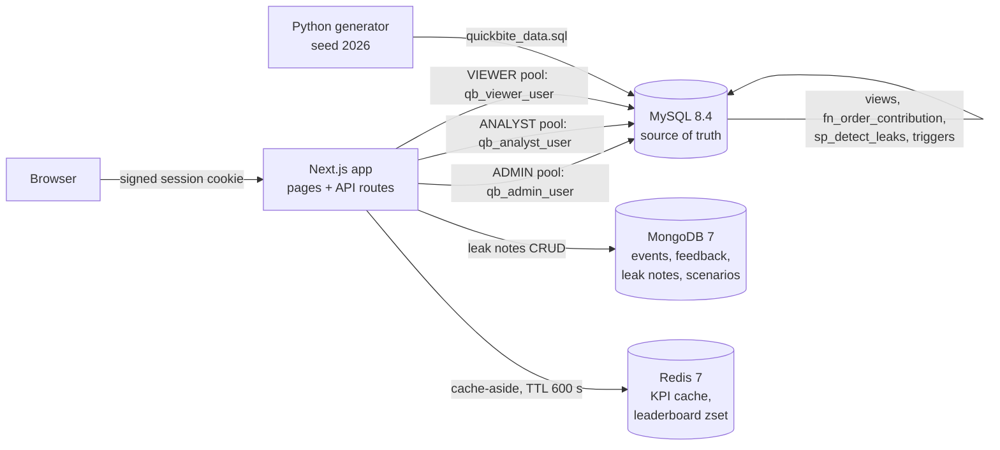

# QuickBite Profit Leakage Analyzer

DBMS mini project, PES University, UE24CS351A (Experiential Learning Level 3).

QuickBite is a food-delivery platform whose orders and revenue keep growing while profit falls. This system:

1. computes the **contribution (profit) of every order** from its revenue, discounts, delivery cost, gateway fee, support cost and unrecovered refunds;
2. finds **where, why and how much** profit leaks, with six leak rules that measure cost *above a benchmark* (never the whole cost);
3. produces **ranked recommendations** (what to fix, at which coupon, partner, restaurant or city), each with an estimated saving and a demand risk;
4. lets analysts keep **leak notes**, shows everything in a web dashboard with **login and role-based access**, and caches the dashboards.

The data is synthetic: 60,000 orders from Nov 2025 to Oct 2026, generated with a fixed seed and six planted leaks. Because the leaks are known in advance, the analysis can be checked against them. In this data, monthly revenue grows from Rs 4.99 lakh to Rs 8.68 lakh while contribution falls from Rs 1.83 lakh (May) to Rs 0.52 lakh (Oct). Three leak types explain 83% of the loss.

## Contents

- [Architecture](#architecture)
- [Technology justification](#technology-justification)
- [Setup from a fresh clone (Mac)](#setup-from-a-fresh-clone-mac)
- [Demo logins](#demo-logins)
- [The web app](#the-web-app)
- [Tests](#tests)
- [Viva demo script](#viva-demo-script)
- [Rubric to file mapping](#rubric-to-file-mapping)
- [Database design](#database-design)
- [Core formulas](#core-formulas)
- [Repository layout](#repository-layout)
- [Troubleshooting](#troubleshooting)

## Architecture



| Part | Technology | Holds |
|---|---|---|
| Source of truth | MySQL 8.4 | 23 tables: orders and money, leak rules and results, recommendations, users, roles, audit log; 5 views, 2 functions + `fn_order_contribution`, 9 triggers, 2 procedures |
| Flexible data | MongoDB 7 | `order_events`, `feedback`, `leak_notes`, `saved_scenarios` (all with `$jsonSchema` validators) |
| Cache | Redis 7 | dashboard KPIs (JSON strings) and the restaurant leak leaderboard (sorted set) |
| App | Next.js 16 (Node) | UI pages and API routes; one MySQL connection pool per role |
| Data | Python 3 (standard library) | deterministic generator with planted leaks |

All three databases run in Docker (`docker-compose.yml`). The web app runs on the Mac with Node.

## Technology justification

Each kind of data lives in the store that fits how it is shaped and used.

| Data | Store | Why this store |
|---|---|---|
| Orders, items, trips, payments, refunds, coupons, customers, restaurants, partners | **MySQL** | Money and relationships. These rows must never contradict each other, so they need foreign keys, CHECK constraints, transactions (a refund and its order commit together) and exact `DECIMAL` arithmetic. The profit formulas join many tables, which is what SQL is built for. |
| Leak rules, leak records, recommendations, users and roles, audit log | **MySQL** | They are computed from the order data and must stay consistent with it. Stored procedures, triggers and per-role privileges (RBAC inside the database) all live next to the data. |
| `order_events` | **MongoDB** | An append-only timeline whose fields depend on the event: a payment failure carries a gateway and error code, a support chat carries minutes and a transcript id. A flexible document per event avoids a sparse table with dozens of nullable columns. |
| `feedback` | **MongoDB** | Free text plus a variable list of tags, read one order at a time; arrays and multikey indexes fit naturally. |
| `leak_notes` | **MongoDB** | Analyst notes: free text, tags, a status, full CRUD, and full-text search. The schema changes with how analysts work. A `$jsonSchema` validator still enforces the essential fields, and the API checks that the linked MySQL id exists. |
| `saved_scenarios` | **MongoDB** | "What if" settings and results whose shape differs from scenario to scenario. |
| Dashboard KPIs and leaderboards | **Redis** | Read on every page load but change only when data or a detection run changes. Caching them for 10 minutes stops repeated scans of 60,000 orders. A sorted set (`ZADD`/`ZRANGE REV`) keeps the restaurant leaderboard already ranked. Keys contain the latest detection run id and the role, so a new run is never served stale data and roles never share results. |

MySQL stays the single source of truth: MongoDB and Redis hold either data that never takes part in the profit calculation (notes, events, feedback, scenarios) or a disposable copy that can be rebuilt at any time (the cache).

## Setup from a fresh clone (Mac)

**You need:** Docker Desktop (running), Python 3 (`python3`), Node.js 20 or newer (`node`, `npm`), and Git. Everything below is typed in the VS Code Terminal (zsh).

```bash
git clone <this repository> quickbite && cd quickbite
cp .env.example .env              # then open .env and set MYSQL_ROOT_PASSWORD and AUTH_SECRET
openssl rand -hex 32              # a good value for AUTH_SECRET
scripts/setup.sh                  # about 2 minutes, see below
cd web && npm start               # http://localhost:3000  (Cmd + click the link)
```

`scripts/setup.sh` does, in order:

1. `docker compose up -d` and waits until MySQL, MongoDB and Redis are **healthy**. On an empty volume MySQL runs `db/mysql/01_schema.sql` … `06_procedures.sql` by itself, and MongoDB runs `db/mongo/01_init.js`.
2. Creates `.venv`, installs `generator/requirements.txt`, and runs `generator/generate_data.py`, which writes `data/generated/quickbite_data.sql`.
3. Loads that file into MySQL (about 410,000 rows in a few seconds; every row is checked against all constraints).
4. Runs `sp_detect_leaks` and `sp_generate_recommendations` as `qb_analyst_user`.
5. In `web/`: `npm ci`, seeds three leak notes linked to real leak rows, and runs `npm run build`.

MySQL is published on host port **3307** (`DB_PORT` in `.env`), so it never clashes with a MySQL already installed on the Mac. Inside Docker it is 3306. MongoDB is on 27017, Redis on 6379.

To do the same steps by hand:

```bash
docker compose up -d && docker compose ps                     # wait for 3 x "healthy"
python3 -m venv .venv && source .venv/bin/activate && pip3 install -r generator/requirements.txt
python3 generator/generate_data.py
docker compose exec -T mysql sh -c 'mysql -uroot -p"$MYSQL_ROOT_PASSWORD" quickbite' < data/generated/quickbite_data.sql
docker compose exec -T mysql sh -c 'mysql -uqb_analyst_user -pAnalyst@Dev123 -t quickbite -e "CALL sp_detect_leaks(\"2025-11-01\", \"2026-11-01\", @run, @leaks); CALL sp_generate_recommendations(@run, @recos); SELECT @run, @leaks, @recos;"'
cd web && npm ci && npm run seed:notes && npm run build && npm start
```

## Demo logins

Development passwords only (set in `db/mysql/03_seed.sql` as bcrypt hashes; the MySQL account passwords are in `db/mysql/02_roles.sql` and `.env.example`).

| Role | Web login | Password | MySQL account used for its queries | Can |
|---|---|---|---|---|
| ADMIN | admin@quickbite.dev | Admin@App123 | qb_admin_user | everything, including Run detection |
| ANALYST | analyst@quickbite.dev | Analyst@App123 | qb_analyst_user | change recommendation status; create/edit/delete own leak notes |
| VIEWER | viewer@quickbite.dev | Viewer@App123 | qb_viewer_user | read every page; every change is refused |

## The web app

| Page | Shows | Who can change things |
|---|---|---|
| Overview | monthly KPIs (`v_monthly_kpi`) and city scorecard (`v_city_scorecard`); a badge says whether they came from Redis or MySQL | read-only |
| Leaks | Pareto of leak types (which make up 80%) and the top 10 leaking restaurants (Redis sorted set) | read-only |
| Recommendations | ranked recommendations with status buttons | analyst/admin; a viewer's click is refused **by MySQL** |
| Leak notes | MongoDB notes; filter by leak type, order, tag, status, text; create, edit, delete | analyst/admin create; author or admin edit/delete; viewer read-only |
| Run detection | runs `sp_detect_leaks` + `sp_generate_recommendations`, then clears the Redis cache | admin only; others see *Access denied* |

API routes (all under `web/app/api/`): `POST auth/login`, `POST auth/logout`, `GET me`, `GET kpi`, `GET leaks`, `GET recommendations`, `PATCH recommendations/:id`, `GET`/`POST notes`, `GET`/`PATCH`/`DELETE notes/:id`, `POST admin/run`.

How login and RBAC work:

- **Login** checks `app_user` with bcrypt. Only this lookup uses the admin MySQL account, because no other role may read `password_hash`. Every attempt, successful or not, is written to `audit_log` (action LOGIN).
- **Session:** an httpOnly cookie holding the user and role, signed with HMAC-SHA256 using `AUTH_SECRET`, valid 8 hours. Changing the role inside the cookie breaks the signature, so the request is rejected.
- **RBAC in the database:** every API call runs on the MySQL account of the user's role. When a viewer presses *Accept* on a recommendation, the request really reaches MySQL, which answers `UPDATE command denied to user 'qb_viewer_user'`; the page shows it as *Access denied by MySQL*. Analysts can update only the `status` column (column-level grant).
- **RBAC in the app:** page and route checks cover what MySQL cannot know about. Run detection is admin-only, and leak notes live in MongoDB, so the API refuses viewers' writes with a clear message.
- **Audit:** the API sets `@app_user_id` on its MySQL connection, so the triggers record which app user changed a recommendation, tuned a rule or ran detection.

## Tests

Run all of them at once (start the app first, in another terminal: `cd web && npm start`):

```bash
scripts/test_all.sh               # prints PASS/FAIL per suite, "ALL SUITES PASSED" at the end
scripts/test_all.sh --no-web      # database suites only
```

| Suite | Run by hand | Expected |
|---|---|---|
| Constraints (DDL) | `docker compose exec -T mysql sh -c 'mysql -uroot -p"$MYSQL_ROOT_PASSWORD" --force quickbite' < db/mysql/tests/constraint_tests.sql` | exactly 16 errors, one per constraint kind, then everything rolled back |
| Generated data | `docker compose exec -T mysql sh -c 'mysql -uroot -p"$MYSQL_ROOT_PASSWORD" -t quickbite' < db/mysql/tests/data_checks.sql` | part A: 11 integrity rules, all 0; part B: the six planted leaks stand out |
| DML demo | `docker compose exec -T mysql sh -c 'mysql -uroot -p"$MYSQL_ROOT_PASSWORD" --force -t quickbite' < db/mysql/demo/dml_demo.sql` | 2 expected errors (CHECK, FK RESTRICT); worked example contribution 28.90; ROLLBACK restores everything |
| Views + function | `docker compose exec -T mysql sh -c 'mysql -uroot -p"$MYSQL_ROOT_PASSWORD" -t quickbite' < db/mysql/tests/view_checks.sql` | every mismatch 0: view = `fn_order_contribution` for all 60,000 orders, totals reconcile, worked example 28.90 |
| Queries | `docker compose exec -T mysql sh -c 'mysql -uqb_analyst_user -pAnalyst@Dev123 -t quickbite' < db/mysql/queries/05_queries.sql` | 20 result tables, no errors |
| Procedures + triggers | `docker compose exec -T mysql sh -c 'mysql -uroot -p"$MYSQL_ROOT_PASSWORD" --force -t quickbite' < db/mysql/tests/procedure_checks.sql` | one primary leak per order, reconciliation holds, 7 expected trigger errors, rolled back |
| MongoDB + Redis | `cd web && npm run test:step7` | 23 passed |
| Web app (end to end) | `cd web && npm run test:step8` (add `-- --run` to also press Run detection) | 28 passed (29 with `--run`) |

## Viva demo script

About 10 minutes. Before you start: the stack is up, `cd web && npm start` is running, and two browser windows are open (one normal, one private).

1. **The problem (Overview, as admin).** Log in as `admin@quickbite.dev`. The monthly table shows closed orders rising from 3,557 to 6,711 a month and revenue growing, while contribution per delivered order falls from about Rs 42 to Rs 8 after the Mega Feast Fest campaign starts in July. Reload the page: the badge changes from *MySQL* to *Redis cache*.
2. **Where it leaks (Leaks).** The Pareto shows DISCOUNT_OVERSPEND, LOW_VALUE_ORDER and UNRECOVERED_REFUND make up 83% of the leak. The leaderboard (a Redis sorted set) puts restaurant 121 first, one of the planted "refunds never charged back" restaurants.
3. **What to do (Recommendations).** The top items: cap FEAST60, review Bengaluru peak/rain incentives, WELCOME100, reroute PAYU. Accept one and point out that the trigger allows only NEW → ACCEPTED/REJECTED → IMPLEMENTED.
4. **RBAC in the database.** In the private window, log in as `viewer@quickbite.dev` and press *Accept*: the red box shows **Access denied by MySQL: UPDATE command denied to user 'qb_viewer_user'**. The app did not stop it; MySQL did. Open *Run detection* in that window: Access denied (admin only).
5. **NoSQL CRUD (Leak notes).** As the analyst, filter by leak type UNRECOVERED_REFUND, create a note linked to a leak record id (its leak type and order are filled in from MySQL), edit its status, then delete it. As the viewer, try to create one: refused.
6. **Detection (Run detection, as admin).** Press the button: about 46,700 leak rows and 49 recommendations in a few seconds, and the cache is cleared. Go back to Overview: the badge says *MySQL* again.
7. **SQL behind it (terminal).** `scripts/test_all.sh` → ALL SUITES PASSED. If asked, show `db/mysql/04_views.sql` (`v_order_financials`), the CTE pipeline in `sp_detect_leaks` (`db/mysql/06_procedures.sql`), and a recursive query (R1 region tree) in `db/mysql/queries/05_queries.sql`.
8. **Constraints (terminal).** Run `constraint_tests.sql` and show that each of the 16 bad statements is rejected by a named constraint.

## Rubric to file mapping

| # | Criterion (marks) | Where |
|---|---|---|
| 1 | ER diagram (2) | `docs/diagrams/QuickBite_ER_Diagram.pdf` (Chen notation, 21 entities, 24 relationships) |
| 1 | Relational schema with keys, relationships, constraints (3) | `docs/diagrams/QuickBite_Relational_Schema.pdf`, `docs/quickbite.dbml` |
| 2 | SQL DDL with constraints (4) | `db/mysql/01_schema.sql` (23 tables, 26 FKs, 47 CHECKs, functional unique index); proof: `db/mysql/tests/constraint_tests.sql` |
| 2 | NoSQL database creation (4) | `db/mongo/01_init.js` (4 collections, `$jsonSchema` validators, 12 indexes incl. text and unique) |
| 2 | Technology justification (1) | [Technology justification](#technology-justification) above |
| 3 | DML (4) | `db/mysql/03_seed.sql` (upserts, INSERT … SELECT), `generator/generate_data.py` → bulk INSERTs, `db/mysql/demo/dml_demo.sql` (INSERT/UPDATE/DELETE, JOINs, JSON_SET, CASCADE vs RESTRICT vs SET NULL, SAVEPOINT) |
| 3 | Nested / correlated / recursive / join queries (4) | `db/mysql/queries/05_queries.sql` (J1-J6, N1-N6, C1-C3, R1-R3, P1-P2) |
| 4 | Procedures/functions, triggers, CTEs (6) | `db/mysql/04_views.sql` (`fn_order_contribution`, views), `db/mysql/06_procedures.sql` (`sp_detect_leaks`, `sp_generate_recommendations`, `fn_delivery_allowance`, `fn_target_exists`, 9 triggers, CTE pipeline, recursive CTE in a trigger); proof: `db/mysql/tests/view_checks.sql`, `db/mysql/tests/procedure_checks.sql` |
| 4 | NoSQL feature with RUD (7) | `web/lib/leakNotes.js` (create, read with filters, update, delete; role rules; MySQL link check), API `web/app/api/notes/`, page `web/app/notes/`, Redis cache `web/lib/cache.js`; proof: `web/scripts/test-step7.mjs` |
| 5 | Next.js interface (3) | `web/app/` pages (Overview, Leaks, Recommendations, Leak notes, Run detection, Login), `web/components/` |
| 5 | Backend/API and DB integration (2) | `web/app/api/` (10 routes), `web/lib/mysql.js` (pool per role), `web/lib/dashboard.js`, `web/lib/detection.js`; proof: `web/scripts/test-step8.mjs` |
| 6 | Authentication + two or more roles + RBAC in the database (4) | `db/mysql/02_roles.sql` (MySQL roles, column-level grants, GRANT/REVOKE), grants in `04_views.sql` and `06_procedures.sql`, `web/lib/auth.js`, `web/lib/session.js`, `web/lib/api.js` |
| 7 | Documentation, Git/GitHub (2) | this README, commit history (one commit per step) |
| 7 | Originality and individual contribution (4) | planted-leak data design, leak rules with JSON benchmarks, reconciliation-capped primary leaks, run-versioned per-role cache |

## Database design

**MySQL objects** (files run in name order on an empty volume):

| File | Contents |
|---|---|
| `01_schema.sql` | 23 tables from the 7-step ER mapping; weak entity `order_cost`; M:N `order_item`, `discount_usage`; recursive FKs on `region` and `customer` |
| `02_roles.sql` | roles `qb_admin`, `qb_analyst`, `qb_viewer`; login accounts; column-level SELECT/UPDATE; a GRANT then REVOKE |
| `03_seed.sql` | region tree (country → zones → states), 9 cities, 6 leak types, 9 leak rules (JSON settings), 3 app users |
| `04_views.sql` | `v_order_financials`, `v_monthly_kpi`, `v_city_scorecard`, `v_restaurant_scorecard`, `v_coupon_performance`, `fn_order_contribution`; grants |
| `06_procedures.sql` | `fn_delivery_allowance`, `fn_target_exists`, 9 triggers, `sp_detect_leaks`, `sp_generate_recommendations`; grants |

**Leak types and rules:**

| Leak type | Leak amount (cost above the benchmark) | Rules |
|---|---|---|
| DISCOUNT_OVERSPEND | platform discount above 15% of subtotal, or every stacked coupon after the largest | 1, 2 |
| DELIVERY_COST_OVERRUN | payout + incentive above (25 + 7 per km) × (1 + tolerance) | 3 (normal), 4 (peak or rain) |
| DELAY_COST | wait-time pay + delay vouchers on orders more than 10 minutes late | 5 |
| UNRECOVERED_REFUND | approved refunds and compensation not recovered | 6 |
| GATEWAY_FEE_EXCESS | gateway fee above 2% of the amount | 7 |
| LOW_VALUE_ORDER | loss of a delivered order with a basket below Rs 149 | 8 |

The largest leak on an order is its **primary** leak. On a loss-making order it is capped at the order's loss, so the primary leaks on loss-making orders never add up to more than their total loss.

**Planted leaks** (fixed by generator seed 2026): L1 Mega Feast Fest coupons FEAST60 + FEASTFREE; L2 ten Hyderabad partners on an old payout slab and high Bengaluru rain incentives; L3 six slow kitchens; L4 five restaurants whose refunds are never charged back; L5 PAYU fee raised from 1.9% to 2.9% on 1 May 2026; L6 tiny baskets with FREEDEL rising from 17% to 27% of orders.

**MongoDB collections:**

| Collection | Validator highlights | Indexes |
|---|---|---|
| `order_events` | event_type and actor enums, date, free `payload` | (order_id, at), (event_type, at) |
| `feedback` | rating 1-5 int, comment ≤ 1000, unique tags | unique order_id, (rating, created_at), tags |
| `leak_notes` | leak_ref {kind, id}, leak_type enum, title 3-120, tags `^[a-z0-9-]{2,30}$`, status enum, author | (leak_type, created_at), order_id, tags, leak_ref, text(title, body) |
| `saved_scenarios` | name, author, params object | unique (author, name) |

**Redis keys:** `qb:<latest detection run id>:<ROLE>:<name>` with a 600-second TTL: `kpi:monthly`, `kpi:cities`, `leaks:pareto` (JSON) and `board:restaurant_leak` (sorted set).

## Core formulas

- **Food subtotal** = Σ quantity × unit_price
- **GMV** = food subtotal + delivery fee + platform fee + packaging fee
- **Revenue** = food subtotal × commission % + delivery fee + platform fee + packaging fee
- **Platform discount** = discount × (1 − restaurant_share_pct / 100)
- **Delivery cost** = partner payout + incentive + wait-time pay
- **Refund loss** = refund + compensation − recovered
- **Contribution** = revenue − platform discount − delivery cost − gateway fee − support cost − refund loss
- Refunds count only when APPROVED or PROCESSED. A **cancelled** order has revenue 0 and platform discount 0, and its cancellation refunds are ignored; it still loses its delivery, gateway, support and compensation costs.
- **Leak amount** = cost in excess of a benchmark (never the whole cost); the largest leak on an order is its **primary** leak.

Worked example (checked by `view_checks.sql` and the DML demo): subtotal 280, commission 18%, fees 30 + 5 + 10, delivery cost 60, gateway fee 6.50 → revenue 95.40, contribution 28.90.

## Repository layout

```
docker-compose.yml                  MySQL 8.4 (host port 3307), MongoDB 7, Redis 7
.env.example                        copy to .env; never commit .env
scripts/setup.sh                    fresh-clone build: containers, data, detection, web build
scripts/test_all.sh                 every test suite with PASS/FAIL
db/mysql/01_schema.sql              23 tables with all constraints (DDL)
db/mysql/02_roles.sql               MySQL roles qb_admin / qb_analyst / qb_viewer
db/mysql/03_seed.sql                regions, cities, leak types, leak rules, app users
db/mysql/04_views.sql               order financials + KPI/scorecard views, fn_order_contribution
db/mysql/06_procedures.sql          functions, triggers, sp_detect_leaks, sp_generate_recommendations
db/mysql/queries/05_queries.sql     20 join, nested, correlated, recursive and Pareto queries
db/mysql/demo/dml_demo.sql          DML demonstration (one transaction, rolled back)
db/mysql/tests/                     constraint, data, view and procedure checks
db/mongo/01_init.js                 MongoDB collections, validators, indexes, sample data
generator/generate_data.py          data generator (standard library, fixed seed)
generator/hash_password.py          bcrypt hash for app_user passwords
data/generated/                     generator output (git-ignored)
web/app/                            Next.js pages and API routes
web/components/                     client components (status buttons, note forms, run button)
web/lib/                            MySQL pools per role, auth, session, leak notes, Redis cache
web/scripts/                        seed-leak-notes, test-step7 (Mongo + Redis), test-step8 (end to end)
docs/diagrams/                      ER diagram and relational schema (PDF)
docs/quickbite.dbml                 DBML for dbdiagram.io, generated from 01_schema.sql
```

Subfolders of `db/mysql/` (`queries/`, `demo/`, `tests/`) are never run automatically.

## Troubleshooting

- **Start again from empty databases:** `docker compose down -v` deletes all MySQL and MongoDB data (the `-v` removes the volumes). Then run `scripts/setup.sh` again.
- **A changed `.sql` file has no effect:** MySQL runs `db/mysql/*.sql` only on an empty volume. Apply it by hand, e.g. `docker compose exec -T mysql sh -c 'mysql -uroot -p"$MYSQL_ROOT_PASSWORD" quickbite' < db/mysql/04_views.sql`, or reset as above.
- **Port 3307 already in use:** change `DB_PORT` in `.env` and run `docker compose up -d` again.
- **Port 3000 already in use:** from `web/`, run `node --env-file=../.env node_modules/next/dist/bin/next start -p 3001` and open http://localhost:3001 (for the tests: `WEB_URL=http://localhost:3001 npm run test:step8`).
- **"AUTH_SECRET is missing":** set `AUTH_SECRET` in `.env` (at least 16 characters).

## Build progress

| Step | Rubric item (marks) | Status |
|---|---|---|
| 0 | ER diagram (2), relational schema (3) | done |
| 1 | Repo + Docker skeleton, Git from day one (part of 2) | done |
| 2 | DDL with constraints (4), DB roles (part of 4) | done: 6 Nov 2026 |
| 3 | Seed data + generator, DML (4) | done: 8 Nov 2026 |
| 4 | Views + `fn_order_contribution` | done: 8 Nov 2026 |
| 5 | Nested / correlated / recursive / join queries (4) | done: 8 Nov 2026 |
| 6 | Procedures, functions, triggers, CTEs (6) | done: 8 Nov 2026 |
| 7 | NoSQL creation (4), NoSQL feature + RUD (7), technology justification (1) | done: 8 Nov 2026 |
| 8 | Next.js UI (3), API integration (2), login + RBAC (4) | done: 8 Nov 2026 |
| 9 | Documentation, demo, viva prep (2 + 4) | done: 8 Nov 2026 (full rebuild from empty volumes verified) |
